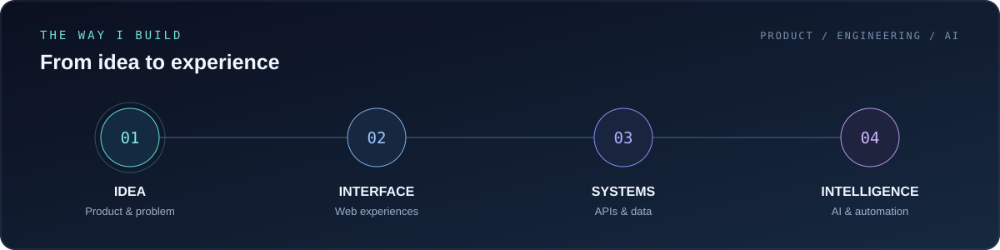

 

 

## Building across the stack

I'm a software engineer and full-stack developer from Spain. I build web products from interface to API, and enjoy connecting thoughtful user experiences with the systems behind them. My work spans web applications, SaaS, integrations, data and AI-assisted workflows.

**Product thinking** · **Full-stack engineering** · **AI exploration**

 

## From idea to experience

<table>
<tr><td width="50%" valign="top"><strong>01 / INTERFACES</strong>  Responsive applications, interactive experiences and design implementation.  REACT · NEXT.JS · ASTRO · TYPESCRIPT · TAILWIND</td>
<td width="50%" valign="top"><strong>02 / SYSTEMS</strong>  APIs, integrations, application logic and data-driven services.  NODE.JS · NESTJS · PYTHON · SQL · NOSQL</td></tr>
<tr><td width="50%" valign="top"><strong>03 / PRODUCTS</strong>  SaaS platforms, dashboards, content tools and workflows built around real needs.  PRODUCT · ARCHITECTURE · USER EXPERIENCE</td>
<td width="50%" valign="top"><strong>04 / EXPLORATION</strong>  AI-assisted features, automation and experiments that turn ideas into useful tools.  AI · AUTOMATION · DEVELOPER EXPERIENCE</td></tr>
</table>

 

## Tools of the trade

<strong>More technologies and tools</strong>

 
HTML · CSS · Java · Spring Boot · SQL Server · Oracle · Jest · Selenium · Bootstrap · Vite · Preact

 

## A little more

I enjoy solving complex problems, learning new tools and working with people who care about building useful things. Outside of code: sport, travel and games.

 
<strong>Have an idea? Let's make it real.</strong>  
<a href="https://www.gabritorres.dev">Explore my portfolio ↗</a> &nbsp; · &nbsp; <a href="mailto:gabritorresdev@gmail.com">Get in touch ↗</a>
  
GABRIEL TORRES · SOFTWARE ENGINEERING · SPAIN

